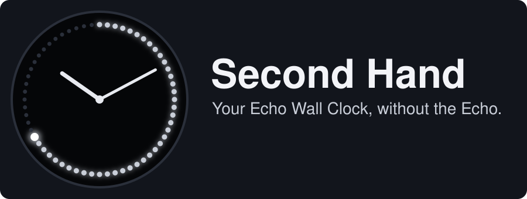

# ⏱️ Second Hand Plugin for Kiosk Satellite

Second Hand gives your Echo Wall Clock a second life. It connects the clock straight to your Kiosk Satellite kiosk, so the clock shows your kiosk's voice timers and keeps the right time, the way it does with an Echo. The clock needs no changes.

See what the clock shows without owning one: [try the clock simulator](https://mpjanofsky.github.io/echo-wall-clock/) in your browser.

## ✨ Features

⏲️ **Voice timers on the clock:** say "set a timer for 10 minutes" to your kiosk and the clock shows it. Pause, resume, add time or cancel by voice and the clock follows.

🔢 **Several timers at once:** run more than one timer and the clock shows them together (tested with four).

🔔 **A pulse when time is up:** the clock pulses once when a timer ends, and stops when you stop the timer.

🕐 **The right time:** Second Hand sets the clock's time and keeps it in sync with your kiosk, including time zone changes.

🔁 **Looks after itself:** if the clock's batteries die or it goes out of range, it reconnects on its own.

🔒 **Local only:** no account, no cloud, and nothing to change on the clock.

Second Hand follows the timers of **the kiosk it runs on**. One kiosk, one clock.

## 📱 Requirements

| | |
|---|---|
| **You need** | An Echo Wall Clock (the Mickey Mouse Edition is reported to work too: confirmed with Second Hand for Home Assistant, not yet tried with this plugin), and a kiosk running Kiosk Satellite 2026.10.30 or newer with Bluetooth turned on and a Voice Satellite configured. |
| **Tested on** | An Echo Show 5 running LineageOS 18.1 (Android 11) |
| **Should work on** | Other Kiosk Satellite kiosks with Bluetooth |

## 🚀 Install

### Community Plugins (Recommended)

Second Hand is listed in [Community Plugins](https://kiosksatellite.com/plugins/). Use the button below to open it in your Kiosk Satellite and install it.

Or search for `Second Hand` in **Settings > Plugin Manager > Browse plugins** in Kiosk Satellite.

### Manual

1. In Kiosk Satellite, open **Settings > Plugin Manager** (or **Plugin Manager** in Remote Admin) and turn on **Enable Plugins**.
2. Choose **Add plugin**, paste `https://github.com/mpjanofsky/second-hand-plugin`, and choose **Preview**.
3. Review the manifest and this README, then choose **Trust and install**.
4. Enable **Second Hand** with the switch on its row.

## 🕰️ Set up your clock

Pairing needs you at the kiosk and the clock. You can start it from Remote Admin.

1. In Plugin Manager, tap Second Hand's row to open its page. Press **Pair**, in Remote Admin or on the kiosk.
2. Press and hold the blue pairing button on the back of the clock (up to 10 seconds) until the light on the front pulses orange. That is pairing mode. Keep it pulsing: Second Hand looks for the clock for 90 seconds, and the page shows its progress.
3. When Android asks to pair, choose **Pair** on the kiosk. If it asks for a PIN instead, type `0000`.

Open the plugin's row in Plugin Manager to check the status. It should say **Connected to the clock.** Start a voice timer and it shows on the clock.

An Echo Wall Clock connects to one device at a time. Pairing it with Second Hand disconnects it from whatever it was paired with before. To give it back, press **Forget**.

## ⚙️ Settings

Three buttons at the top set the clock up, with progress shown under each button:

| Button | What it does |
|---|---|
| **Pair** | Finds the clock while it is in pairing mode (light pulsing orange) and pairs with it. |
| **Reconnect** | Tries to connect now instead of waiting for the next automatic try, then says whether the clock answered. |
| **Forget** | Removes the pairing so the clock can be paired with something else. |

The buttons need Kiosk Satellite 2026.10.30 or later.

| Setting | What it does |
|---|---|
| **Clock address** | Fills in when you pair and clears when you forget the clock. |
| **Show status tile** | Shows Second Hand's status on the Remote Admin Overview: green when connected, amber while retrying, red when Bluetooth is off or the pairing is gone. On by default. |

**Deprecated:** the **Pair clock**, **Reconnect to clock** and **Forget clock** actions, which you could show in the kiosk drawer, give a gesture or expose to Home Assistant, still work in this release. They will be removed in a later release, so use the buttons instead.

## 🔒 Privacy

Everything stays on the kiosk. Second Hand reads the kiosk's timer events and talks to the clock over Bluetooth. It doesn't use the internet and sends nothing about you or your kiosk anywhere. The clock's Bluetooth address is saved in the plugin's settings on the kiosk.

## 🧰 Troubleshooting

The status line shows in the plugin's row in Plugin Manager, on the kiosk or in Remote Admin.

| What you see | What to try |
|---|---|
| **No clock paired yet** or **The clock is no longer paired** | Press **Pair** with the clock in pairing mode. |
| **The clock was not found** | Press **Pair** again, and keep the clock in pairing mode (light pulsing orange) the whole time. |
| **Clock not reachable** or **Clock still not reachable** | Check the clock has batteries and is in range, and that nothing else has taken the pairing. Right after pairing, the first connection can take a few minutes and Second Hand keeps trying on its own. To try now, press **Reconnect**. |
| The clock stays blank | Say a timer out loud to the kiosk itself. Second Hand only shows the kiosk's own timers. |

## 🙏 Credits

- The [Kiosk Satellite plugin template](https://github.com/jxlarrea/kiosk-satellite-plugin-hello-world) by jxlarrea.
- The Echo Wall Clock is Amazon's. Second Hand talks to it over Bluetooth and doesn't change the clock.

Not affiliated with or endorsed by Kiosk Satellite or Amazon.

## 💬 Feedback and contributing

- Found a bug, have an idea, or a kiosk it works on that isn't listed above? Open an issue.
- For developers: [building and changing it](docs/DEVELOPING.md).

🤖 Built with a lot of help from Claude, who worked with me on most of the design, code, tests and docs.

Code is Apache-2.0 (see [LICENSE](LICENSE) and [NOTICE](NOTICE)).
